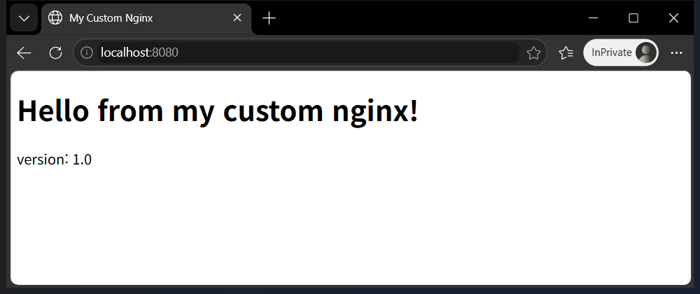
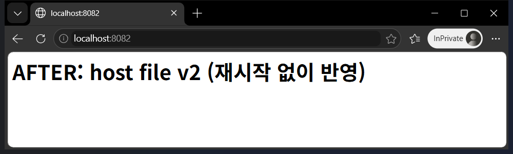
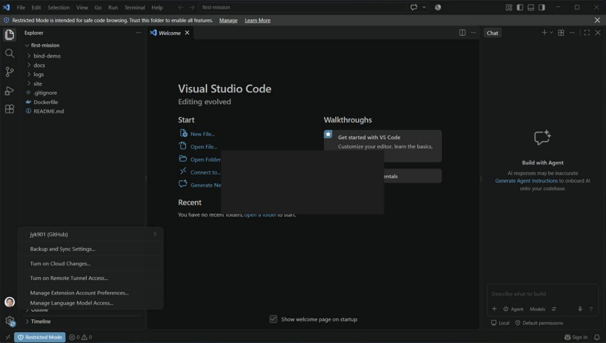

# 1차 미션 – 내 컴퓨터에 개발자용 작업실 꾸미기

## 1) 프로젝트 개요
터미널 · Docker · Git/GitHub 세 가지 도구를 직접 손으로 세팅하고, **실행 결과(로그/접속/데이터 유지)** 로 검증한 기록이다.
핵심 목표는 "내 컴퓨터에서만 돌아가는 코드"가 아니라 **누가 실행해도 같은 결과가 나오는 환경**(이미지/컨테이너, 포트 매핑, 볼륨)을 만드는 것이다.
모든 로그는 이 저장소의 `logs/` 폴더에 원문 그대로 저장돼 있고, 아래에 코드블록으로 포함했다.

## 2) 실행 환경
| 항목 | 값 |
|---|---|
| OS | Windows 11 Home (10.0.26200) |
| 셸/터미널 | Git Bash (bash 5.3, 터미널 조작) + PowerShell (Docker Desktop·WSL 설치) |
| Docker | Docker Desktop 4.97.0 / Docker Engine 29.9.2 (WSL2 백엔드, WSL 3.0.3.0) |
| Git | 2.55.0.windows.5 |
| GitHub CLI | gh 로그인 계정 `jyk901` (HTTPS) |

## 3) 수행 체크리스트
- [x] 터미널 기본 조작 및 폴더 구성 (pwd, ls -la, mkdir, touch, cp, mv, rm, cat)
- [x] 절대/상대 경로 비교
- [x] 권한 변경 실습 (파일 1개 + 디렉터리 1개, 변경 전/후 비교)
- [x] Docker 설치/점검 (`--version`, `info`)
- [x] Docker 기본 운영 (`images`, `ps`, `ps -a`, `logs`, `stats`)
- [x] hello-world 실행
- [x] ubuntu 컨테이너 실행/내부 진입/종료·유지 차이 관찰
- [x] Dockerfile 작성 → 커스텀 이미지 빌드/실행
- [x] 포트 매핑 접속 (8080, 8081 두 번)
- [x] 바인드 마운트 반영 (변경 전/후 비교)
- [x] 볼륨 영속성 (컨테이너 삭제 전/후 비교)
- [x] Git 사용자/기본 브랜치 설정 + `git config --list` 기록
- [x] GitHub 로그인 및 저장소 연동 (gh 인증 + push)
- [x] 트러블슈팅 3건
- [x] 브라우저 접속 스크린샷 (주소창 포함)
- [x] VSCode GitHub 로그인 + 저장소 연동

## 4) 저장소 구조
```
first-mission/
├── README.md              # 이 문서 (수행 로그 + 증거)
├── Dockerfile             # nginx:alpine 기반 커스텀 이미지
├── site/index.html        # 컨테이너에 COPY 되는 웹 서버 콘텐츠
├── bind-demo/index.html   # 바인드 마운트 실습용 파일 (최종 상태 사본)
├── docs/screenshots/      # 브라우저 접속 화면 (8080, 8081, 8082)
└── logs/                  # 명령 + 출력 원문 로그 (01~09)
```

## 5) 검증 방법과 증거 위치
| 항목 | 검증 명령 | 결과 위치 |
|---|---|---|
| 터미널 조작 | `pwd`, `ls -la`, `mkdir`, `cp`, `mv`, `rm` 등 | [logs/01_terminal.txt](logs/01_terminal.txt) |
| 권한 | `chmod 600/755/644/700/000` + `stat -c %a` + 다른 사용자(nobody) 접근 | [logs/04_permissions.txt](logs/04_permissions.txt) |
| Docker 점검/운영 | `docker --version/info/images/ps -a/logs/stats` | [logs/02_docker_basic.txt](logs/02_docker_basic.txt) |
| hello-world | `docker run hello-world` | [logs/03_hello.txt](logs/03_hello.txt) |
| 빌드 + 포트 매핑 | `docker build`, `docker run -p`, `curl` | [logs/05_build_port.txt](logs/05_build_port.txt) |
| 바인드 마운트 | `docker run -v`, 호스트 파일 수정 후 `curl` | [logs/07_bind_mount_fixed.txt](logs/07_bind_mount_fixed.txt) |
| 볼륨 영속성 | `docker volume create`, 컨테이너 `rm -f` 후 재연결 | [logs/06_mount_volume.txt](logs/06_mount_volume.txt) |
| 최종 상태 | `docker ps -a`, `docker images` | [logs/08_final_ps.txt](logs/08_final_ps.txt) |
| Git/GitHub | `git config --list`, `gh auth status` | [logs/09_git_config.txt](logs/09_git_config.txt) |

## 6) 수행 로그

### 6-1) 터미널 조작 (위치 확인·목록·이동·생성·복사·이동/이름변경·삭제·내용 확인·빈 파일)
```bash
$ bash --version | head -1
GNU bash, version 5.3.15(2)-release (x86_64-pc-cygwin)
$ mkdir -p ~/codyssey/practice && cd ~/codyssey/practice
$ pwd
/c/Users/jyk90/codyssey/practice
$ ls -la
total 0
drwxr-xr-x 1 jyk90 197609 0 Oct 31 16:19 .
drwxr-xr-x 1 jyk90 197609 0 Oct 31 16:19 ..
$ touch empty.txt .hidden
$ echo "hello codyssey" > note.txt
$ cat note.txt
hello codyssey
$ mkdir -p docs/sub
$ ls -la   (숨김 파일 포함)
total 1
drwxr-xr-x 1 jyk90 197609  0 Oct 31 16:19 .
drwxr-xr-x 1 jyk90 197609  0 Oct 31 16:19 ..
-rw-r--r-- 1 jyk90 197609  0 Oct 31 16:19 .hidden
drwxr-xr-x 1 jyk90 197609  0 Oct 31 16:19 docs
-rw-r--r-- 1 jyk90 197609  0 Oct 31 16:19 empty.txt
-rw-r--r-- 1 jyk90 197609 15 Oct 31 16:19 note.txt
$ cp note.txt docs/note_copy.txt
$ mv docs/note_copy.txt docs/sub/renamed.txt   (이동+이름변경)
$ cd docs/sub && pwd && ls -l
/c/Users/jyk90/codyssey/practice/docs/sub
total 1
-rw-r--r-- 1 jyk90 197609 15 Oct 31 16:19 renamed.txt
$ cat docs/sub/renamed.txt
hello codyssey
$ rm empty.txt .hidden docs/sub/renamed.txt && rmdir docs/sub docs   (삭제)
$ ls -la
total 1
drwxr-xr-x 1 jyk90 197609  0 Oct 31 16:19 .
drwxr-xr-x 1 jyk90 197609  0 Oct 31 16:19 ..
-rw-r--r-- 1 jyk90 197609 15 Oct 31 16:19 note.txt
--- 절대 경로 vs 상대 경로 ---
$ cat /c/Users/jyk90/codyssey/practice/note.txt   (절대)
hello codyssey
$ cd ~ && cat codyssey/practice/note.txt   (상대: 현재 위치 기준)
hello codyssey
```
- **절대 경로**는 루트(`/`)부터 시작해 어디서 실행해도 같은 파일을 가리킨다(`/c/Users/jyk90/codyssey/practice/note.txt`).
  **상대 경로**는 *현재 위치* 기준이라 `cd ~` 후에는 `codyssey/practice/note.txt`처럼 다르게 쓴다.

### 6-2) 권한 실습
Windows(NTFS/FAT32)는 `chmod`가 실질적 의미가 없어서, **Linux 컨테이너(ubuntu) 안에서** 실습했다.
```bash
# 권한 실습: Windows(NTFS)는 chmod가 의미 없어 Linux 컨테이너(ubuntu) 내부에서 수행
$ ls -l pfile.txt; ls -ld pdir   (변경 전)
-rw-r--r-- 1 root root 7 Oct 31 07:20 pfile.txt
drwxr-xr-x 2 root root 4096 Oct 31 07:20 pdir
$ chmod 600 pfile.txt  → 소유자만 rw
-rw------- 1 root root 7 Oct 31 07:20 pfile.txt
600 pfile.txt
$ chmod 755 pdir  → rwxr-xr-x
drwxr-xr-x 2 root root 4096 Oct 31 07:20 pdir
755 pdir
$ chmod 644 pfile.txt → rw-r--r--
644 pfile.txt
$ chmod 700 pdir ; 일반 사용자(nobody)로 접근 시도
drwx------ 2 root root 4096 Oct 31 07:20 pdir
ls: cannot open directory '/tmp/pdir': Permission denied
$ chmod 000 pfile.txt; nobody가 읽기 시도
cat: /tmp/pfile.txt: Permission denied
secret
dir-ok
```
- 권한은 `r(4) w(2) x(1)`의 합을 **소유자/그룹/기타** 순으로 3자리로 쓴다. `755 = rwx r-x r-x`(소유자 전체, 나머지 읽기·실행), `644 = rw- r-- r--`(소유자만 쓰기).
- 디렉터리의 `x`는 "안으로 들어갈 수 있는 권한"이다. `700`으로 바꾸자 nobody 사용자의 `ls`가 `Permission denied`가 됐다.

### 6-3) Docker 설치/점검, 기본 운영, 컨테이너 실행
```bash
$ docker --version
Docker version 29.9.2, build a82e528
$ docker info (발췌)
 Containers: 0
 Images: 0
 Server Version: 29.9.2
 Storage Driver: overlayfs
 Operating System: Docker Desktop
 OSType: linux
$ docker run hello-world
Unable to find image 'hello-world:latest' locally
latest: Pulling from library/hello-world
4f55086f7dd0: Pulling fs layer
4f55086f7dd0: Download complete
4f55086f7dd0: Pull complete
d5e71e642bf5: Download complete
Digest: sha256:c567b231f65614688711a75f31518a064258a51d442117a3e771a3a8fdba78ef
Status: Downloaded newer image for hello-world:latest
$ docker pull ubuntu:22.04
Digest: sha256:076e7bf82319619f28dd0aa9c02ab34b055ad37100395b4f49a2ffba04fb5e11
Status: Downloaded newer image for ubuntu:22.04
docker.io/library/ubuntu:22.04
$ docker images
IMAGE                ID             DISK USAGE   CONTENT SIZE   EXTRA
hello-world:latest   c567b231f656       25.9kB         9.49kB        
ubuntu:22.04         076e7bf82319        119MB         31.7MB        
$ docker run --name ubuntu-test ubuntu:22.04 echo "hi from ubuntu"   (실행 후 종료)
hi from ubuntu
$ docker ps ; docker ps -a
CONTAINER ID   IMAGE     COMMAND   CREATED   STATUS    PORTS     NAMES
CONTAINER ID   IMAGE          COMMAND                   CREATED         STATUS                    PORTS     NAMES
c6f2885dbe4f   ubuntu:22.04   "echo 'hi from ubunt…"   2 seconds ago   Exited (0) 1 second ago             ubuntu-test
$ docker run -d --name ubuntu-keep ubuntu:22.04 sleep infinity   (유지)
e1ffa5e249057ffbffecfda5fef7d1bb470e0f16d1613284edca7ed21d7ee292
$ docker ps
CONTAINER ID   IMAGE          COMMAND            CREATED        STATUS                  PORTS     NAMES
e1ffa5e24905   ubuntu:22.04   "sleep infinity"   1 second ago   Up Less than a second             ubuntu-keep
$ docker exec ubuntu-keep bash -c "ls / | head -5; echo inside-container; cat /etc/os-release | head -2"
bin
boot
dev
etc
home
inside-container
PRETTY_NAME="Ubuntu 22.04.5 LTS"
NAME="Ubuntu"
$ docker logs ubuntu-test
hi from ubuntu
$ docker stats --no-stream
CONTAINER ID   NAME          CPU %     MEM USAGE / LIMIT     MEM %     NET I/O         BLOCK I/O   PIDS
e1ffa5e24905   ubuntu-keep   0.00%     2.113MiB / 7.568GiB   0.03%     1.17kB / 126B   0B / 0B     1
$ docker stop ubuntu-keep
ubuntu-keep
$ docker ps -a
CONTAINER ID   IMAGE          COMMAND                   CREATED          STATUS                                PORTS     NAMES
e1ffa5e24905   ubuntu:22.04   "sleep infinity"          8 seconds ago    Exited (137) Less than a second ago             ubuntu-keep
c6f2885dbe4f   ubuntu:22.04   "echo 'hi from ubunt…"   10 seconds ago   Exited (0) 9 seconds ago                        ubuntu-test
```
```bash
$ docker run --rm hello-world   (이미지 캐시됨 → 메시지 확인)

Hello from Docker!
This message shows that your installation appears to be working correctly.

To generate this message, Docker took the following steps:
 1. The Docker client contacted the Docker daemon.
```
- **종료/유지 차이**: `docker run ubuntu echo ...`는 명령이 끝나면 컨테이너도 `Exited (0)`로 끝난다. `sleep infinity`처럼 계속 도는 프로세스(PID 1)가 있으면 `Up` 상태로 유지되고 `docker exec`로 들어갈 수 있다. `docker stop`으로 멈추면 `Exited (137)`(SIGKILL 종료 코드)이 된다.

### 6-4) Dockerfile 기반 커스텀 이미지
**선택한 방식: (A) 웹 서버 베이스 이미지 + 정적 콘텐츠 교체.** 베이스는 `nginx:alpine`.

`Dockerfile`
```dockerfile
# 베이스: 공식 nginx 경량 이미지 (옵션 A: 웹 서버 베이스 + 정적 콘텐츠 교체)
FROM nginx:alpine
LABEL org.opencontainers.image.title="My-custom-nginx"
ENV APP_ENV=dev
COPY site/ /usr/share/nginx/html/
HEALTHCHECK --interval=10s --timeout=3s CMD wget -qO- http://localhost/ >/dev/null || exit 1
```
| 커스텀 포인트 | 목적 |
|---|---|
| `FROM nginx:alpine` | 검증된 경량 웹 서버 이미지를 재사용 |
| `LABEL ...title` | 이미지 메타데이터(식별) |
| `ENV APP_ENV=dev` | 설정을 코드와 분리해 컨테이너 안에서 확인 가능 (`docker exec ... env`로 확인) |
| `COPY site/ ...` | 기본 페이지를 내 콘텐츠로 교체 |
| `HEALTHCHECK` | 컨테이너가 실제로 응답하는지 자동 점검 (`healthy` 확인) |

### 6-5) 빌드 · 포트 매핑 (8080, 8081)
```bash
$ docker build -t my-web:1.0 .
#6 DONE 0.1s

#7 exporting to image
#7 exporting layers 0.0s done
#7 exporting manifest sha256:cce23ae82074133388d6f9c0b32d3a067d44919d3063bcc8d42cc3993bae46c8 done
#7 exporting config sha256:1575f4b76c67a831700a558929b4401ba37edffd00ceca1174531dfa36d95e02 done
#7 exporting attestation manifest sha256:43593fafca126b448daaf6c7e01affff651ab398e33708c4b22ce44a8e0250a9 0.0s done
#7 exporting manifest list sha256:3695e1e6e7727dfdec7422d0e5d8f3c0832ba1cf5e4f6521213c6b834a501777 done
#7 naming to docker.io/library/my-web:1.0 done
#7 unpacking to docker.io/library/my-web:1.0
#7 unpacking to docker.io/library/my-web:1.0 0.7s done
#7 DONE 0.8s
$ docker run -d -p 8080:80 --name web-8080 my-web:1.0
0f7d3c21aab86017a19c4c8364c8539a07588577677e0c9d8825b8a49bfa00c4
$ docker run -d -p 8081:80 --name web-8081 my-web:1.0
149ba3934d5ebf5923e0710c94ceb49656734bdc10ca20d443f9f1156e66363c
$ docker ps
NAMES      IMAGE        PORTS                                     STATUS
web-8081   my-web:1.0   0.0.0.0:8081->80/tcp, [::]:8081->80/tcp   Up 4 seconds (health: starting)
web-8080   my-web:1.0   0.0.0.0:8080->80/tcp, [::]:8080->80/tcp   Up 5 seconds (health: starting)
$ curl -s http://localhost:8080
<!doctype html>
<html lang="ko"><head><meta charset="utf-8"><title>My Custom Nginx</title></head>
<body><h1>Hello from my custom nginx!</h1><p>version: 1.0</p></body></html>
$ curl -s http://localhost:8081
<!doctype html>
<html lang="ko"><head><meta charset="utf-8"><title>My Custom Nginx</title></head>
<body><h1>Hello from my custom nginx!</h1><p>version: 1.0</p></body></html>
$ curl -sI http://localhost:8080 | head -3
HTTP/1.1 200 OK
Server: nginx/1.31.8
Date: Sat, 31 Oct 2026 07:20:28 GMT
$ docker logs web-8080 | tail -3
2026/10/31 07:20:21 [notice] 1#1: start worker process 45
172.17.0.1 - - [31/Oct/2026:07:20:28 +0000] "GET / HTTP/1.1" 200 174 "-" "curl/8.21.0" "-"
172.17.0.1 - - [31/Oct/2026:07:20:28 +0000] "HEAD / HTTP/1.1" 200 0 "-" "curl/8.21.0" "-"
$ docker exec web-8080 env | grep APP_ENV
APP_ENV=dev
$ docker inspect --format "{{.Config.Labels}}" my-web:1.0
map[maintainer:NGINX Docker Maintainers <docker-maint@nginx.com> org.opencontainers.image.title:My-custom-nginx]
$ docker stats --no-stream
CONTAINER ID   NAME       CPU %     MEM USAGE / LIMIT     MEM %     NET I/O           BLOCK I/O     PIDS
149ba3934d5e   web-8081   0.00%     14.66MiB / 7.568GiB   0.19%     1.59kB / 917B     0B / 8.19kB   17
0f7d3c21aab8   web-8080   3.19%     14.92MiB / 7.568GiB   0.19%     2.41kB / 1.43kB   0B / 12.3kB   17
```
**브라우저 접속 화면 (주소창에 포트 표시)**

| 8080 | 8081 |
|---|---|
|  |  |

- 컨테이너는 격리된 네트워크를 쓰므로, **호스트 포트 → 컨테이너 포트(`-p 8080:80`)** 로 연결해야 밖에서 접속할 수 있다. 같은 이미지를 두 포트(8080, 8081)에 띄워도 같은 응답이 나온다(재현성).

### 6-6) 바인드 마운트 (호스트 변경이 즉시 반영)
처음 시도는 실패했고(트러블슈팅 1), C: 경로로 해결한 결과가 아래다.
```bash
# 원인 진단: E: 드라이브는 이동식(Removable, FAT32) → Docker(WSL2)에서 비어 보임
$ docker run --rm -v "E:/.../bind-demo:/t:ro" alpine ls -la /t   → (빈 디렉터리)
$ docker run --rm -v "C:/Users/jyk90/codyssey/bind-demo:/t:ro" alpine ls /t
index.html

# 해결: C: 드라이브 경로로 바인드 마운트
$ echo "<h1>BEFORE: host file v1</h1>" > C:/Users/jyk90/codyssey/bind-demo/index.html
$ docker run -d --name web-bind -p 8082:80 -v "C:/Users/jyk90/codyssey/bind-demo:/usr/share/nginx/html:ro" nginx:alpine
d910a1e57a76ef2ce7ceff0b6af6e592f633cc9ecfd1fa15cd4e034e704fccf1
$ curl -s http://localhost:8082   (변경 전)
<h1>BEFORE: host file v1</h1>
$ echo "<h1>AFTER: host file v2 (재시작 없이 반영)</h1>" > C:/Users/jyk90/codyssey/bind-demo/index.html
$ curl -s http://localhost:8082   (변경 후)
<h1>AFTER: host file v2 (재시작 없이 반영)</h1>
$ docker inspect web-bind --format "{{json .Mounts}}"
[{"Type":"bind","Source":"C:/Users/jyk90/codyssey/bind-demo","Destination":"/usr/share/nginx/html","Mode":"ro","RW":false,"Propagation":"rprivate"}]
```
**바인드 마운트 변경 후 브라우저 화면 (8082)**



(스크린샷용으로 `bind-demo/index.html`에 `<meta charset="utf-8">`를 추가했다. 선언이 없으면 한글이 깨져 보였다.)

- 호스트 파일을 수정만 했는데 **컨테이너 재시작 없이** 응답이 `BEFORE → AFTER`로 바뀌었다.

### 6-7) Docker 볼륨 영속성
(아래 로그 앞부분의 바인드 마운트 403은 트러블슈팅 1에서 설명한 첫 시도 결과다.)
```bash
$ cat bind-demo/index.html   (호스트 파일, 변경 전)
<h1>BEFORE: host file v1</h1>
$ docker run -d --name web-bind -p 8082:80 -v "<host>/bind-demo:/usr/share/nginx/html:ro" nginx:alpine
Unable to find image 'nginx:alpine' locally
alpine: Pulling from library/nginx
Digest: sha256:785835ea65db4bba6f021acc0f3be91b0fef76a53fe41f8588c6698d2aed0606
Status: Downloaded newer image for nginx:alpine
fd4961023189a6ee7c8fd3afefc9a44cd644ea0e094256ae75fa81b4db1ea161
$ curl -s http://localhost:8082   (변경 전)
<html>
<head><title>403 Forbidden</title></head>
<body>
<center><h1>403 Forbidden</h1></center>
<hr><center>nginx/1.31.8</center>
</body>
</html>
$ echo "<h1>AFTER: host file v2 (컨테이너 재시작 없이 반영)</h1>" > bind-demo/index.html
$ curl -s http://localhost:8082   (변경 후)
<html>
<head><title>403 Forbidden</title></head>
<body>
<center><h1>403 Forbidden</h1></center>
<hr><center>nginx/1.31.8</center>
</body>
</html>
$ docker exec web-bind cat /usr/share/nginx/html/index.html
cat: can't open '/usr/share/nginx/html/index.html': No such file or directory

===== Docker 볼륨 영속성 =====
$ docker volume create mydata
mydata
$ docker run -d --name vol-test -v mydata:/data ubuntu:22.04 sleep infinity
1a74335c66837f238bea83adb5b038d46a77089fd979d158455c74a92cd4832a
$ docker exec vol-test bash -c "echo hi > /data/hello.txt && cat /data/hello.txt"
hi
$ docker rm -f vol-test   (컨테이너 삭제)
vol-test
$ docker ps -a --filter name=vol-test
CONTAINER ID   IMAGE     COMMAND   CREATED   STATUS    PORTS     NAMES
$ docker volume ls
DRIVER    VOLUME NAME
local     mydata
$ docker run -d --name vol-test2 -v mydata:/data ubuntu:22.04 sleep infinity
6259ae2f79c1ae2f0e587819764edb8fc367cad2bf1a978368d3f41589ed3f2e
$ docker exec vol-test2 cat /data/hello.txt   (삭제 후에도 유지)
hi
$ docker volume inspect mydata
[
    {
        "CreatedAt": "2026-10-31T07:20:50Z",
        "Driver": "local",
        "Labels": null,
        "Mountpoint": "/var/lib/docker/volumes/mydata/_data",
        "Name": "mydata",
        "Options": null,
        "Scope": "local"
    }
]
--- 대조: 볼륨 없이 쓴 데이터는 컨테이너 삭제 시 사라짐 ---
ls: cannot access '/tmp/x.txt': No such file or directory
```
- 컨테이너(`vol-test`)를 삭제해도 볼륨 `mydata`의 `hello.txt`가 새 컨테이너(`vol-test2`)에서 그대로 읽혔다. 볼륨 없이 쓴 파일(`/tmp/x.txt`)은 컨테이너 삭제와 함께 사라졌다.

### 6-8) 최종 상태
```bash
NAMES         STATUS                            PORTS
web-bind      Up 5 seconds                      0.0.0.0:8082->80/tcp, [::]:8082->80/tcp
vol-test2     Up 39 seconds                     
web-8081      Up About a minute (healthy)       0.0.0.0:8081->80/tcp, [::]:8081->80/tcp
web-8080      Up About a minute (healthy)       0.0.0.0:8080->80/tcp, [::]:8080->80/tcp
ubuntu-keep   Exited (137) About a minute ago   
ubuntu-test   Exited (0) About a minute ago     
IMAGE                ID             DISK USAGE   CONTENT SIZE   EXTRA
alpine:latest        be2656061b53         13MB         3.94MB        
hello-world:latest   c567b231f656       25.9kB         9.49kB        
my-web:1.0           3695e1e6e772       93.6MB         26.3MB   U    
nginx:alpine         785835ea65db       94.5MB         27.2MB   U    
ubuntu:22.04         076e7bf82319        119MB         31.7MB   U    
```

### 6-9) Git 설정 및 GitHub 연동
```bash
$ git --version
git version 2.55.0.windows.5
$ git config --global --list | (이메일 마스킹)
user.name=jeongyoungki
user.email=j***@hanmail.net
init.defaultbranch=main
$ git config --list --show-origin | grep -E "user\.|init.defaultbranch" (이메일 마스킹)
file:C:/Program Files/Git/etc/gitconfig	init.defaultbranch=master
file:C:/Users/jyk90/.gitconfig	user.name=jeongyoungki
file:C:/Users/jyk90/.gitconfig	user.email=j***@hanmail.net
file:C:/Users/jyk90/.gitconfig	init.defaultbranch=main
$ git branch --show-current
fatal: detected dubious ownership in repository at 'E:/__000 코디세이/first-mission'
'E:/__000 코디세이/first-mission' is on a file system that does not record ownership
To add an exception for this directory, call:

	git config --global --add safe.directory 'E:/__000 코디세이/first-mission'
$ gh auth status   (토큰은 gh가 마스킹/미표시)
github.com
  ✓ Logged in to github.com account jyk901 (keyring)
  - Active account: true
  - Git operations protocol: https
  - Token: ****masked****
  - Token scopes: 'gist', 'read:org', 'repo'
# 트러블슈팅: dubious ownership (E:는 소유권 미기록 FAT32)
$ git branch --show-current   (설정 전) → fatal: detected dubious ownership
$ git config --global --add safe.directory "E:/__000 코디세이/first-mission"
$ git config --global --get-all safe.directory
E:/__000 코디세이/first-mission
$ git branch --show-current
main
$ git config --local user.email → GitHub noreply 주소 사용(개인 이메일 공개 방지)
core.repositoryformatversion=0
user.email=<id>+jyk901@users.noreply.github.com
```
**VSCode GitHub 로그인 및 저장소 연동**



- 저장소: https://github.com/jyk901/codyssey-first-mission (공개, `main`을 `origin`으로 push)
- VSCode 안에서 같은 폴더를 열었고, 계정 메뉴에 `jyk901 (GitHub)`가 표시된다.

- **Git**은 내 컴퓨터에서 변경 이력을 관리하는 *로컬 버전관리 도구*, **GitHub**는 그 저장소를 원격에 올려 공유·협업하는 *플랫폼*이다.
- 개인 이메일은 마스킹했고, 커밋 이메일은 GitHub noreply 주소를 사용했다. 토큰은 `gh`가 키링에 보관하며 이 저장소 어디에도 기록하지 않았다.

## 7) 트러블슈팅

### ① 바인드 마운트가 `403 Forbidden` (마운트 폴더가 비어 보임)
- **문제**: `-v "E:/.../bind-demo:/usr/share/nginx/html:ro"` 로 실행하니 nginx가 403, 컨테이너 안 `ls`가 빈 디렉터리.
- **원인 가설**: ① 파일 권한 ② 경로 인식 오류(한글 경로) ③ 드라이브가 Docker에 공유되지 않음.
- **확인**: `docker inspect`의 Source는 올바른 경로였지만 내용이 비어 있었다. 같은 파일을 `C:` 경로로 마운트하면 `index.html`이 보였고, `Get-Volume`으로 E:가 `Removable / FAT32` 임을 확인 → ③.
- **해결**: 바인드 마운트용 폴더를 `C:\Users\<user>\codyssey\bind-demo` 로 옮겨 실행(로그 07). 저장소 사본은 `bind-demo/`.
- **재현 시 주의**: README를 따라 할 때 프로젝트를 **이동식/외장 드라이브에 두지 말고** 내장 드라이브에서 실행한다.

### ② Docker Desktop "WSL not installed" / 엔진 시작 불가
- **문제**: Docker Desktop 설치 후 `docker info`가 `Docker Desktop is unable to start`, 앱에는 "WSL not installed" 창.
- **원인 가설**: WSL2 미설치 또는 가상화 기능 비활성.
- **확인**: `wsl --status`가 설치 안 됨을 표시, `Get-WindowsOptionalFeature`로 VirtualMachinePlatform/WSL 기능과 하이퍼바이저 상태 점검.
- **해결**: 관리자 권한으로 `wsl --install --no-distribution` 실행 → `wsl --version` 으로 WSL 3.0.3.0 확인 → Docker Desktop 재시작 후 `docker info` 성공.

### ③ Git `detected dubious ownership`
- **문제**: `git init` 후 `git branch --show-current`가 `fatal: detected dubious ownership`.
- **원인 가설**: 폴더 소유자와 현재 사용자가 달라 Git이 보안상 거부.
- **확인**: 메시지의 `file system that does not record ownership` → E:(FAT32)는 소유권 정보가 없음.
- **해결**: 이 폴더만 예외 등록 `git config --global --add safe.directory "E:/__000 코디세이/first-mission"` (전체 `*` 허용은 피함).

## 8) 재현 방법
```bash
git clone https://github.com/jyk901/codyssey-first-mission.git && cd codyssey-first-mission
docker build -t my-web:1.0 .
docker run -d -p 8080:80 --name web-8080 my-web:1.0
curl http://localhost:8080
```
- 위 명령은 Docker Desktop(WSL2)이 실행 중이어야 한다. 경로(`C:/Users/jyk90/...`)는 내 PC 기준이므로 본인 경로로 바꿔 쓴다.

## 9) 한계 (정직한 기록)
- **VSCode 화면**: 계정 메뉴에 `jyk901 (GitHub)` 로그인 상태가 표시된다(아래). 화면 중앙의 어두운 사각형은 캡처 도구가 가린 다른 창이다. VSCode 폴더 신뢰(Workspace Trust) 창은 닫기만 해서 *Restricted Mode*로 남아 있다.
- 로그는 실행 당시 출력을 모은 것이며, 시각/ID 등은 재실행 시 달라진다.
